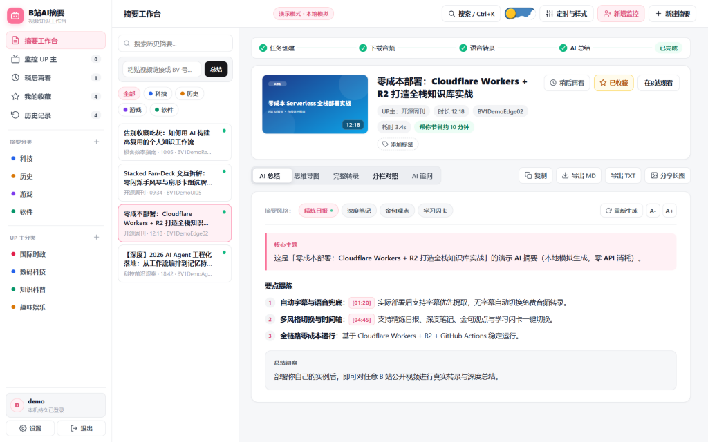
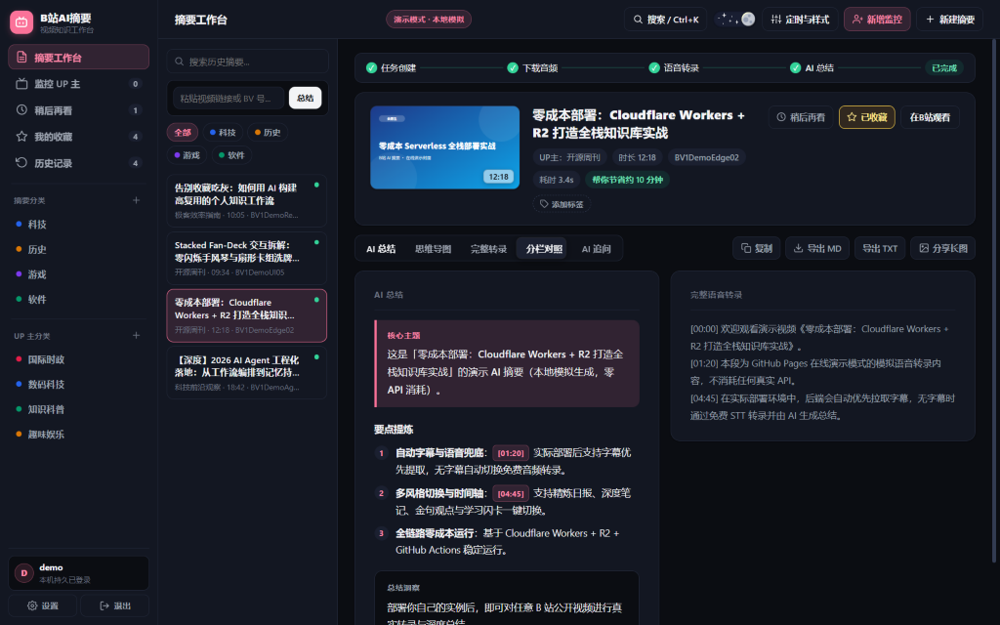
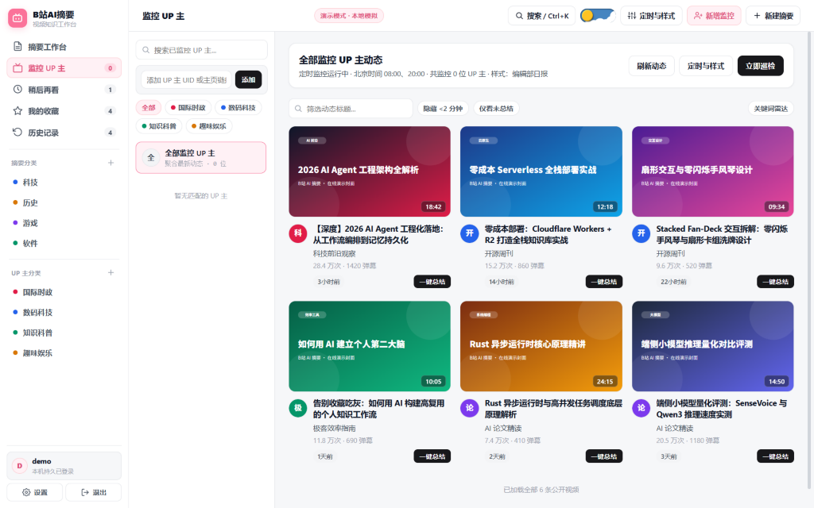
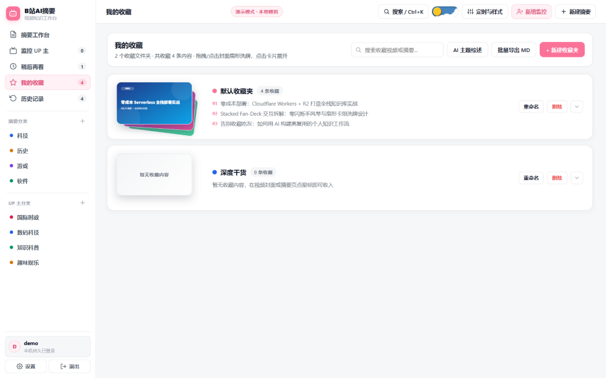
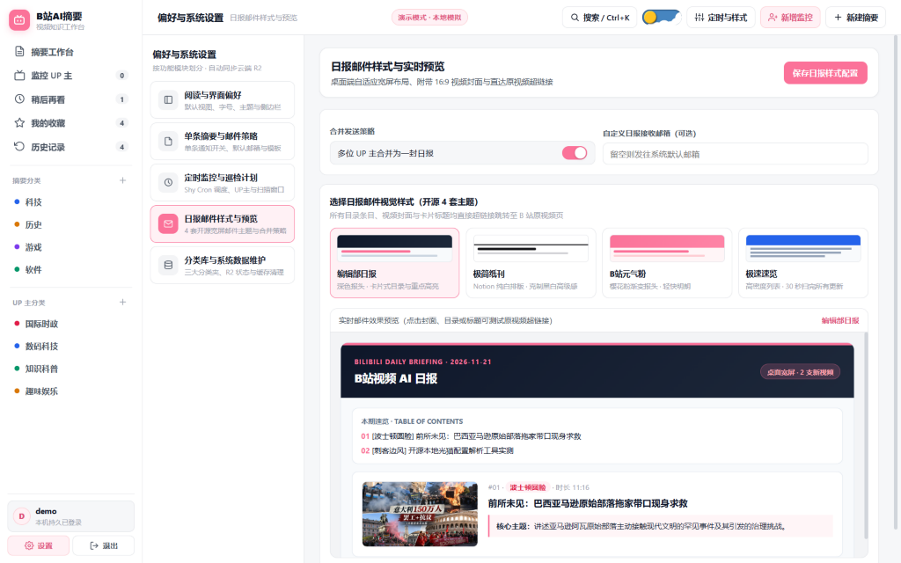
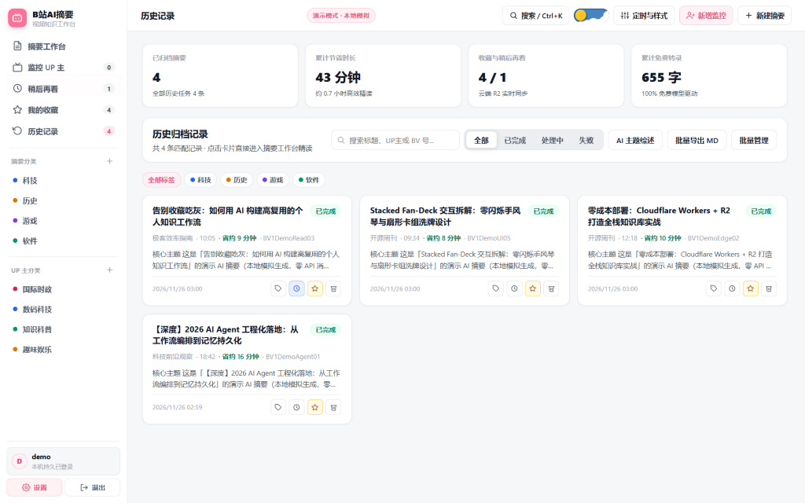

# 📺 B站 AI 摘要工作台（Bilibili AI Summary）

> 全程免费、零服务器运维的 **B 站视频知识工作台 & UP 主自动监控推送系统**。  
> 基于 **Cloudflare Workers + Cloudflare R2 + GitHub Actions + Vercel Bilibili Proxy** 构建。

🔗 **在线交互演示（GitHub Pages）**：**[https://shiranzby.github.io/bilibili-ai-summary/](https://shiranzby.github.io/bilibili-ai-summary/)**  
> 演示站内置多条模拟视频、4 风格摘要与模拟提交流程（纯前端本地模拟，不消耗任何真实 API 额度）。

---

## 🖼️ 界面与邮件预览

<table>
  <tr>
    <td align="center" width="50%">
      <b>摘要工作台（浅色模式 · AI 总结与进度追踪）</b><br/><br/>
      
    </td>
    <td align="center" width="50%">
      <b>摘要工作台（深色模式 · 分栏对照与时间轴）</b><br/><br/>
      
    </td>
  </tr>
  <tr>
    <td align="center" width="50%">
      <b>监控 UP 主动态流 & 快捷筛选</b><br/><br/>
      
    </td>
    <td align="center" width="50%">
      <b>我的收藏（Stacked Fan-Deck 扇形叠层卡组）</b><br/><br/>
      
    </td>
  </tr>
  <tr>
    <td align="center" width="50%">
      <b>设置中心 & 4 套邮件日报实时预览</b><br/><br/>
      
    </td>
    <td align="center" width="50%">
      <b>历史归档 & KPI 效率统计</b><br/><br/>
      
    </td>
  </tr>
</table>

---

## ✨ 核心功能一览

### 1. 摘要工作台（Summary Workspace）
- **实时任务进度条**：精确追踪 `任务创建 → 下载音频 → 语音转录 → AI 总结` 真实执行阶段。
- **4 种 AI 摘要风格 & 独立缓存**：支持 **精炼日报 / 深度笔记 / 金句观点 / 学习闪卡** 一键切换，已生成风格自动缓存到 R2（再次切换秒开），并提供单独「重新生成」按钮。
- **多视图知识消费**：
  - **AI 总结 / 思维导图 / 完整转录 / 分栏对照 / AI 追问**：围绕当前视频随时提问。
  - **时间轴 `[mm:ss]` 直达**：摘要与转录中的时间戳自动转为可点击链接，直接跳转到 B 站对应播放秒数。
  - **多格式导出**：一键复制、导出 `.md` / `.txt`，以及绘制带视频封面的 **高颜值分享长图 PNG**（自动适配深色 / 浅色主题）。

### 2. 监控 UP 主 & 关键词雷达
- **UP 主动态聚合**：支持按 UP 主分类标签聚合浏览，支持动态标题筛选、`隐藏 <2 分钟`、`仅看未总结` 快捷过滤。
- **封面悬停预览 & 中号弹窗播放器**：
  - 光标悬停视频封面约 `350ms` 自动静音加载并播放预览视频。
  - 点击封面或悬停时按 `Enter` 打开居中的 16:9 中号播放器弹窗（不遮挡全屏），支持 `Space` 播放/暂停、`Esc` 关闭。
- **关键词雷达**：订阅感兴趣的技术或主题关键词，实时搜索 B 站最新投稿并一键总结或加入「稍后再看」。

### 3. 稍后再看 & 我的收藏（Stacked Fan-Deck）
- **稍后再看队列**：支持勾选多条视频批量派发 AI 总结，并支持 **导入 B 站公开收藏夹**（输入 `fid` 或空间收藏夹链接即可导入）。
- **扇形叠层收藏夹**：集成自研开源组件 [Stacked Fan-Deck](https://github.com/shiranzby/stacked-fan-deck)，支持封面扇形洗牌交互、零闪烁手风琴展开、多收藏夹归类。
- **AI 跨视频主题综述**：在「我的收藏」或「历史记录」中勾选 2–6 条已完成摘要，一键生成跨视频核心共识、观点对比与学习路线。
- **批量导出 Markdown**：一键将收藏或勾选的多条摘要合并导出为标准 `.md` 文档。

### 4. 全局效率工具 & 个性化设置
- **全局 `Ctrl+K` Spotlight 命令面板**（顶栏同步提供快捷入口）：实时全文检索历史摘要、语音转录与 UP 主，或直接粘贴 B 站链接 / BV 号秒速提交（自动识别多 P 视频并支持选择分 P）。
- **独立二级设置中心**：包含账号登录鉴权、默认模板与偏好设置、4 套邮件日报视觉主题（`editorial` / `minimal` / `bilibili` / `compact`）实时预览、分类库与 R2 存储状态管理。
- **深浅色丝滑切换**：支持日夜主题切换与 View-Transition 动画，并针对移动端窄屏做了双列 UP 主卡片与两行历史摘要适配。

---

## 🏗️ 系统架构与免费技术栈

| 模块 | 职责 | 技术方案 / 免费额度 |
|------|------|------|
| **前端 & API 网关** | Web 工作台托管、R2 读写、鉴权、边缘 AI 追问/重生成/综述、媒体流代理 | **Cloudflare Workers + R2**（免费层） |
| **B 站接口中继** | 解析视频详情/分 P、公开字幕、预览 MP4、收藏夹、搜索与音频分片 | **Vercel Serverless**（`vercel-bili-proxy/`） |
| **异步音视频处理** | 字幕优先直取 → 无字幕自动下载音频 → STT → AI 总结 → 邮件推送 | **GitHub Actions**（2000 分钟/月免费） |
| **免费语音识别** | 将视频人声转为文字（`.m4s` 直接改名 `.m4a` 上传，无需 `ffmpeg`） | **硅基流动 `SenseVoiceSmall`**（可选 `GROQ_API_KEY` 免费 `whisper-large-v3-turbo` 优先） |
| **免费 AI 总结** | 日报/笔记/金句/闪卡生成、追问对话、跨视频主题综述 | **硅基流动免费模型池**（`Qwen/Qwen3-8B` 等） |
| **邮件日报推送** | 定时巡检与单条任务结果推送 | **QQ 邮箱 / 任意 SMTP** |

> **处理链路优化**：提交任务时，工作流优先尝试快速拉取 B 站公开 CC/AI 字幕（4 秒超时无阻断回退），有字幕时直接跳过音频下载与 STT；无字幕时自动下载音频并调用免费 STT 模型，兼顾速度与覆盖率。

---

## 🚀 快速部署指南

### 1. 部署 B 站中继服务（Vercel）

进入 `vercel-bili-proxy/` 目录并部署到 Vercel：

```bash
cd vercel-bili-proxy
npx vercel --prod
```

部署完成后记录你的域名（例如 `https://your-bili-proxy.vercel.app`）。

### 2. 配置 GitHub Secrets

在你的 GitHub 仓库 `Settings → Secrets and variables → Actions` 中添加以下 Secrets：

| Secret 名称 | 说明 | 必填 |
|-------------|------|------|
| `SILICONFLOW_API_KEY` | 硅基流动 API Key（用于免费语音识别与 AI 总结） | ✅ |
| `SMTP_USER` | 发件邮箱（如 `your_account@qq.com`） | ✅ |
| `SMTP_PASS` | 邮箱 SMTP 授权码 | ✅ |
| `SMTP_TO` | 默认收件邮箱 | ✅ |
| `BILI_PROXY_URL` | 第 1 步部署的 Vercel 中继地址 | 建议 |
| `WORKER_URL` | 第 3 步部署的 Cloudflare Worker 地址 | 建议 |
| `GROQ_API_KEY` | Groq Cloud API Key（可选，用于免费 Whisper 优先转录） | 可选 |
| `SILICONFLOW_STT_MODEL` | 语音识别模型（默认 `FunAudioLLM/SenseVoiceSmall`） | 可选 |
| `SILICONFLOW_SUMMARY_MODEL` | 总结模型（默认 `Qwen/Qwen3-8B`） | 可选 |

### 3. 部署 Cloudflare Worker & R2

1. 创建名为 `bilibili-summary` 的 Cloudflare R2 存储桶，并核对 `cloudflare/wrangler.toml` 中的绑定名称。
2. 部署 Worker：

```bash
cd cloudflare
npx wrangler deploy
```

3. 在 Cloudflare Dashboard → Workers → `Settings → Variables and Secrets` 中配置以下环境变量（均为敏感凭据，请勿硬编码到仓库）：

| 变量名 | 说明 |
|--------|------|
| `GH_TOKEN` | GitHub Personal Access Token（需具备 `repo` 与 `workflow` 权限） |
| `GH_OWNER` | GitHub 用户名 |
| `GH_REPO` | 仓库名（如 `bilibili-ai-summary`） |
| `SILICONFLOW_API_KEY` | 硅基流动 Key（供边缘 AI 追问、风格切换、跨视频综述使用） |
| `BILI_PROXY_URL` | Vercel 中继地址 |
| `ADMIN_USER` / `ADMIN_PASS` | Web 控制台登录账号与密码 |
| `AUTH_SECRET` | Cookie/Token 签名随机密钥 |
| `CRON_TRIGGER_SECRET` | 定时巡检触发鉴权密钥（可选） |

---

## 📁 目录结构

```text
├── .github/workflows/
│   └── summary.yml            # GitHub Actions 工作流（单条处理 + 定时 UP 主监控）
├── bilibili_summary/          # Python 处理核心
│   ├── audio_transcriber.py   # 字幕优先直取 + CDN/中继音频下载 + Groq/硅基流动 STT
│   ├── bili_api.py            # B 站视频信息与 UP 主动态拉取
│   ├── summarizer.py          # AI 总结生成
│   ├── process_single.py      # 单条视频处理入口（支持 --p 分P参数）
│   ├── monitor.py             # 多 UP 主定时监控与日报聚合推送
│   └── send_result_email.py   # 4 套样式 HTML 邮件渲染与发送
├── cloudflare/
│   ├── worker.js              # Cloudflare Worker 后端 API + 单页 Web 工作台
│   └── wrangler.toml          # Wrangler 部署与 R2 绑定配置
└── vercel-bili-proxy/
    └── api/                   # B 站无风控 Serverless 中继接口
        ├── bili-info.js       # 视频元信息与分 P 列表
        ├── bili-preview.js    # 悬停预览 & 弹窗播放 MP4 直链解析
        ├── bili-subtitle.js   # CC/AI 公开字幕快速提取
        ├── bili-audio.js      # HTTP Range 音频流分片代理
        ├── bili-fav.js        # 公开收藏夹视频列表拉取
        ├── bili-search.js     # 关键词搜索（关键词雷达）
        ├── bili-up.js         # UP 主信息与投稿列表
        └── bili-card.js       # 视频卡片信息
```

---

## 🔒 安全与隐私说明

- 所有 API Key、SMTP 授权码、GitHub PAT 及管理员密码均通过 **GitHub Secrets** 与 **Cloudflare Worker Secrets** 注入，**仓库代码不包含任何真实凭据**。
- 媒体流代理 `/api/bili-media` 仅放行 B 站官方 CDN 域名（`*.bilivideo.com` / `*.bilivideo.cn` / `*.hdslb.com` / `*.akamaized.net`），防止 SSRF 滥用。
